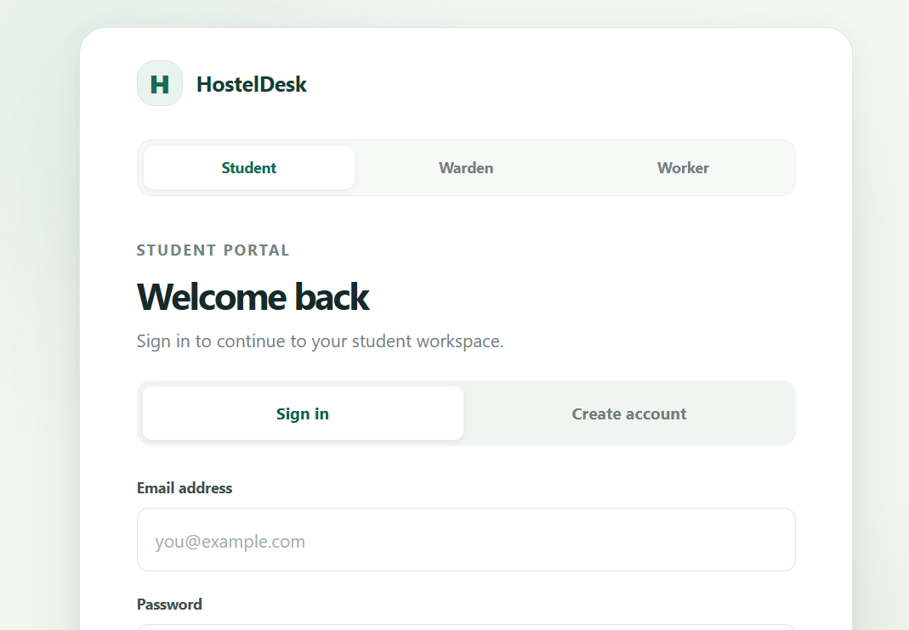
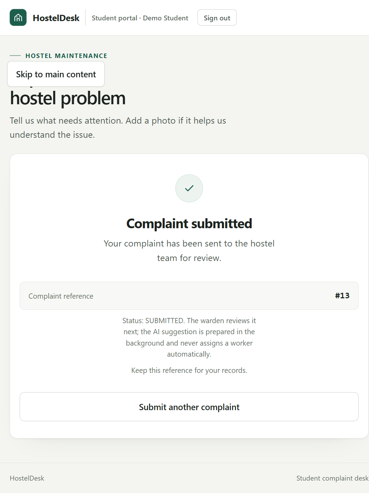
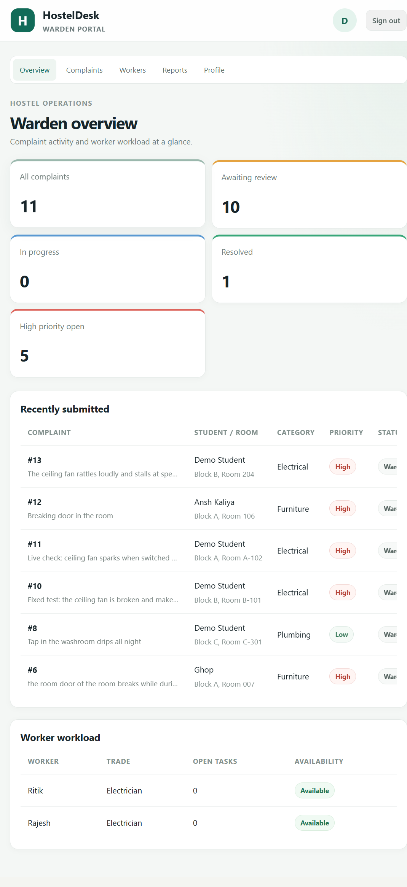
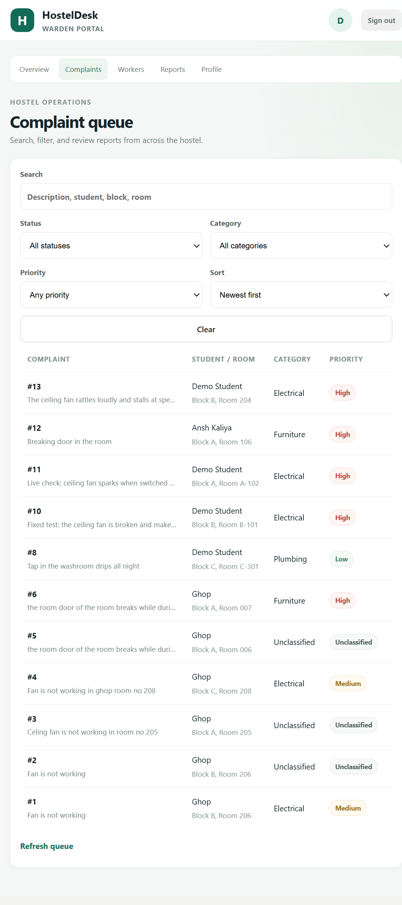
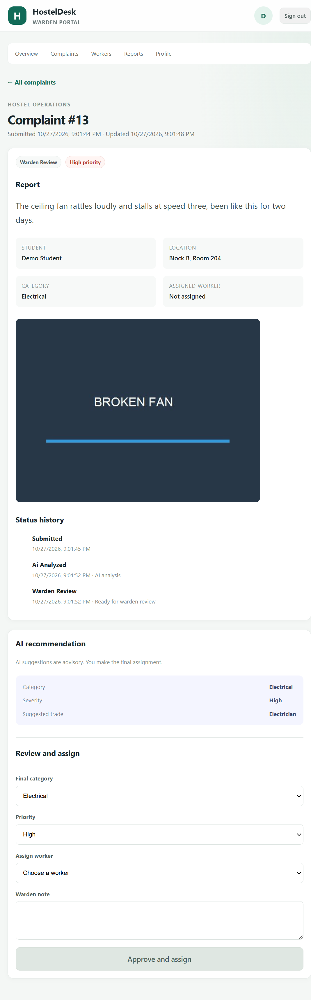
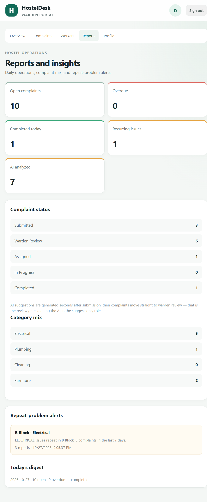
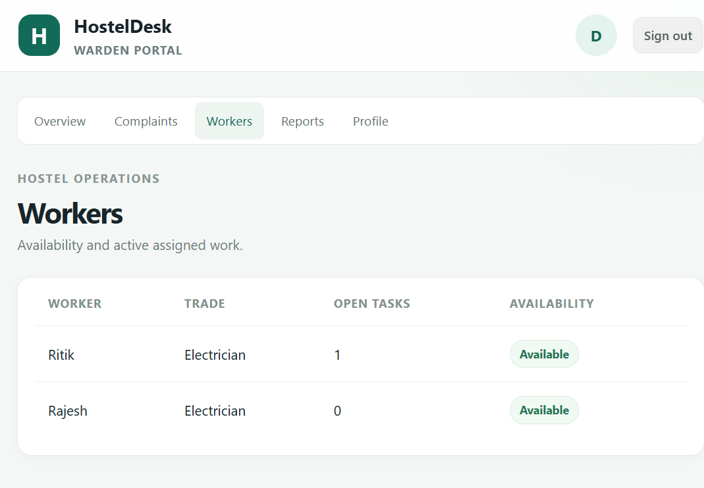
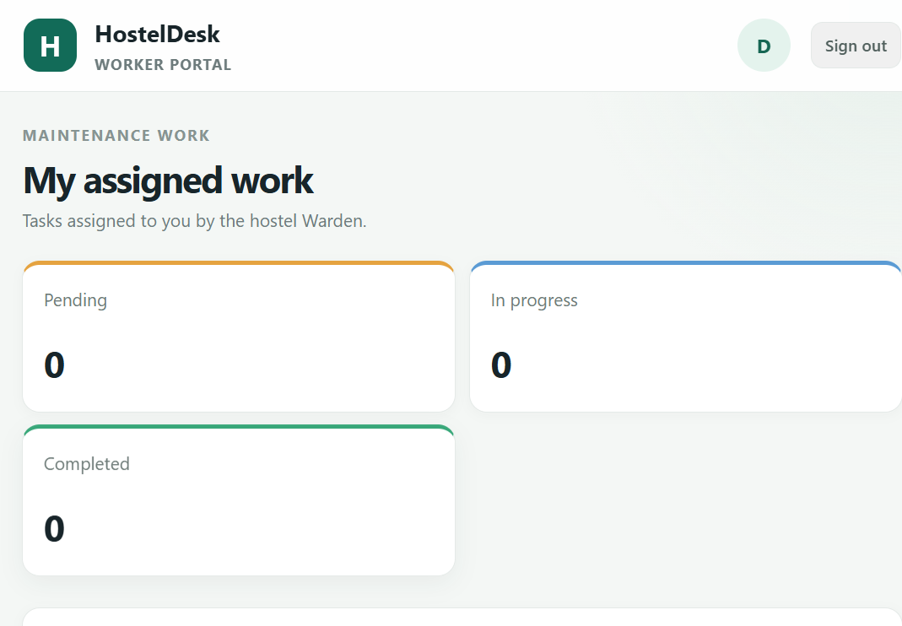
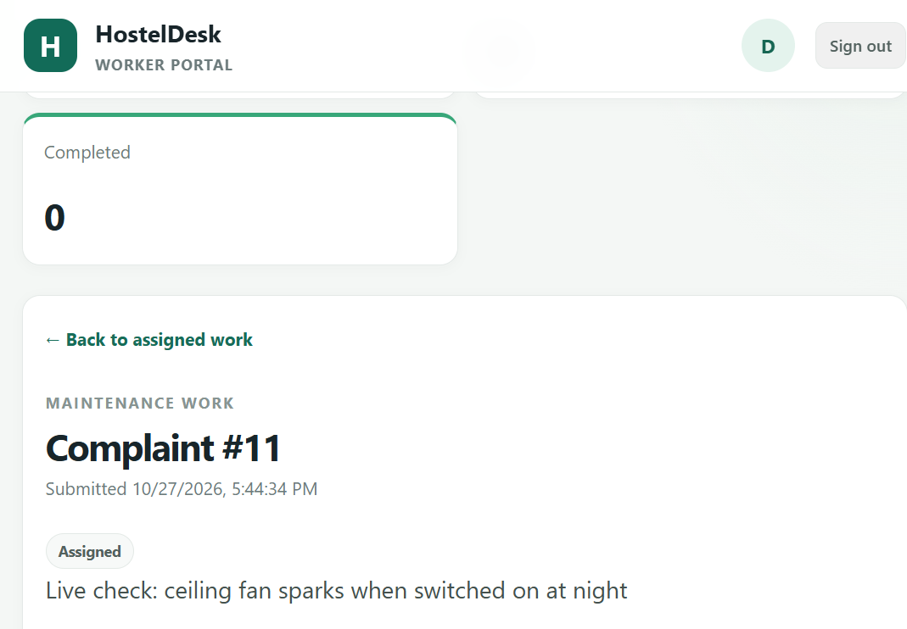
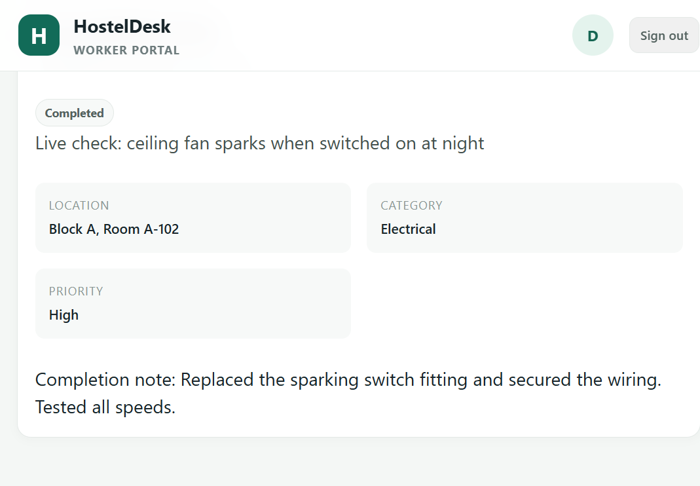

# 🛏️ HostelDesk

> **AI-assisted hostel complaint & maintenance desk — AI suggests, the Warden decides.**

🌐 **[Live Demo → https://hosteldesk.aurio.workers.dev](https://hosteldesk.aurio.workers.dev/)**

| Deployment | URL | Status |
| --- | --- | --- |
| **Frontend (Student / Warden / Worker portals)** | [hosteldesk.aurio.workers.dev](https://hosteldesk.aurio.workers.dev/) | 🟢 Live on Cloudflare Workers |
| **Backend API (FastAPI)** | [hosteldesk-qgx8.onrender.com](https://hosteldesk-qgx8.onrender.com/) | 🟢 Live on Render |
| **API Docs (Swagger)** | [hosteldesk-qgx8.onrender.com/docs](https://hosteldesk-qgx8.onrender.com/docs) | 🟢 Live |
| **Database & Auth & Storage** | Supabase (PostgreSQL + Auth + private Storage bucket) | 🟢 Live |

---

## 🎬 What it does

HostelDesk turns a hostel complaint **photo + one-line note** into a structured, trackable maintenance task:

1. 📸 A **Student** uploads a photo of the problem (broken fan, leaking tap…) with a short note
2. 🤖 **AI** analyzes the photo + text and suggests a **category**, **severity**, and **worker type**
3. 🧑‍💼 The **Warden** reviews the AI recommendation, edits if needed, and approves → a task is created
4. 🔧 The assigned **Worker** picks up the task, marks it in-progress, completes it with a note
5. 📱 The **Student** sees live status updates end-to-end

The warden also gets **repeat-problem alerts** and a **daily digest** — no AI required for those, just deterministic rules.

> ### The core principle
> **AI suggests; the Warden decides.** The model never assigns a worker or decides about students — the warden's review creates the task.

---

## 🧩 Key Features

### Student Portal
- Photo upload (client-side validated, downsized to ≤1600px, re-encoded JPEG, metadata stripped)
- One-line complaint description + block/room
- Live complaint status tracking & history

### Warden Portal
- Complete complaint queue with filters (status / category / severity / search / sort)
- AI-generated category, severity & suggested worker
- **Approve or edit** AI recommendations before any assignment
- Repeat-problem alerts (deterministic rule: same block + category recurring complaints)
- Daily digest + worker workload overview

### Worker Portal
- Assigned tasks, complaint details
- ASSIGNED → IN_PROGRESS → COMPLETED workflow with completion notes

### AI Engine (Gemini / Gemma, server-side only)
- Categories: **Electrical · Plumbing · Cleaning · Furniture**
- Severity: **Low · Medium · High**
- Worker suggestions: **Electrician · Plumber · Cleaner · Carpenter**
- Graceful fallback: if AI is unavailable, the complaint lands directly in `WARDEN_REVIEW` for manual categorization — the flow never blocks

---

## 🔄 Complaint Lifecycle

```text
SUBMITTED → AI_ANALYZED → WARDEN_REVIEW → ASSIGNED → IN_PROGRESS → COMPLETED
```

---

## 🏗️ Architecture

```text
              https://hosteldesk.aurio.workers.dev
              Student  ·  Warden  ·  Worker (React SPA)
                            │ HTTPS
                            ▼
              https://hosteldesk-qgx8.onrender.com
              FastAPI (auth, complaints, tasks, digest)
               │            │              │
               ▼            ▼              ▼
      Supabase Auth   Supabase Postgres   Gemini/Gemma API
      (email+token)   (RLS-protected)     (classification)
               │            │
               ▼            ▼
      Private Storage  Alembic migrations
      (complaint photos)
```

**Security model:**
- Photos are stored in a **private** Supabase Storage bucket; the DB keeps only the storage key
- The **service-role key never leaves the backend** — the browser only uses the public publishable key
- Row-Level Security policies on every table; a dedicated non-owner `hosteldesk_app` DB role runs the API
- All AI calls happen server-side; no AI keys in frontend code

---

## 🛠️ Tech Stack

| Layer | Tech |
| --- | --- |
| Frontend | React 19 · Vite · plain CSS |
| Backend | Python 3.11 · FastAPI · SQLAlchemy 2.x · Pydantic v2 · Alembic |
| Database | Supabase PostgreSQL (with RLS) |
| Auth | Supabase Auth (role-based signup: Student / Warden / Worker) |
| Storage | Supabase Storage — private `complaint-photos` bucket |
| AI | Gemini API (server-side REST, env-configurable model — `gemini-2.5-flash` in production) |
| Hosting | Cloudflare Workers (frontend static assets) · Render (backend) |
| Tests | pytest — 74 backend tests |

---

## 🧪 Try the live demo

**Sign up directly on the live site** — registration is a single step (choose a role → name, email, password → dashboard opens). No email confirmation needed.

Suggested demo walkthrough (one complaint, all three roles):

```text
1. Sign up as Student      → upload a photo of a broken fan + short note
2. Sign up as Warden       → see the complaint AI-tagged ELECTRICAL / HIGH / Electrician → approve
3. Sign up as Worker       → electrician sees the task → mark In Progress → Complete with note
4. Back in the Student tab → status shows COMPLETED
5. Warden                  → check repeat-problem alerts + daily digest
```

> 💡 Open the three roles in separate browser tabs/incognito windows for the smoothest demo.

**Demo accounts on the live site** (also usable by judges):

| Role | Email | Password |
| --- | --- | --- |
| Student | `demo.student@hosteldesk.dev` | `DemoStudent2026!` |
| Warden | `demo.warden@hosteldesk.dev` | `DemoWarden2026!` |
| Worker | `demo.worker@hosteldesk.dev` | `DemoWorker2026!` |

---

## 📸 Screenshots (from the live deployment)

**Student portal**




**Warden portal**







**Worker portal**






---

## 📂 Project Structure

```text
HostelDesk/
│
├── frontend/            # React app (all three role portals)
│   ├── src/pages/       #   Student / Warden / Worker screens
│   ├── src/services/    #   Supabase + API clients
│   ├── wrangler.jsonc   #   Cloudflare Workers static-assets deploy
│   └── .env.example     #   Vite build-time environment template
│
├── backend/             # FastAPI service
│   ├── app/             #   routes, services, schemas, db, core
│   ├── alembic/         #   DB migrations (incl. RLS policy migration)
│   ├── tests/           #   69 pytest tests
│   ├── seed.py          #   demo data seeder
│   └── .env.example     #   full backend environment template
│
├── Readme.md            # this file
└── LICENSE              # MIT
```

---

## 🚀 Run it locally

### 1. Backend (FastAPI)

```bash
cd backend
python -m venv .venv
# Windows: .venv\Scripts\activate   |   macOS/Linux: source .venv/bin/activate
pip install -r requirements.txt
copy .env.example .env              # then fill in your keys (see below)

python -m alembic upgrade head      # create tables
python seed.py                      # optional demo data
uvicorn app.main:app --reload --port 8000
```

Swagger UI: <http://127.0.0.1:8000/docs>

> Without `GEMINI_API_KEY` or Supabase keys the app still runs: AI is skipped (complaints go straight to warden review) and photos fall back to the local `uploads/` folder.

### 2. Frontend (Vite)

```bash
cd frontend
npm install
copy .env.example .env.local        # then fill in the three VITE_ vars
npm run dev
```

The dev proxy forwards API calls to `127.0.0.1:8000`.

---

## 🔐 Environment Variables

Full templates with comments live in [`backend/.env.example`](backend/.env.example) and [`frontend/.env.example`](frontend/.env.example).

**Backend (`backend/.env`) — essentials:**

```env
DATABASE_URL=postgresql+psycopg2://<role>:<password>@<host>:5432/postgres
SUPABASE_URL=https://<project-ref>.supabase.co
SUPABASE_SERVICE_ROLE_KEY=<server-side only — never in the browser>
GEMINI_API_KEY=<google ai studio key>
CORS_ORIGINS=http://localhost:5173,https://hosteldesk.aurio.workers.dev
```

**Frontend (`frontend/.env.local`) — all three build-time vars are required:**

```env
VITE_SUPABASE_URL=https://<project-ref>.supabase.co
VITE_SUPABASE_PUBLISHABLE_KEY=<public publishable key>
VITE_API_BASE_URL=https://hosteldesk-qgx8.onrender.com
```

> ⚠️ **Never** commit real `.env` files, put the service-role key in frontend code, or upload real student records.

---

## ☁️ Deployment (how this repo is hosted)

- **Frontend → Cloudflare Workers** (static assets, SPA fallback so `/warden/*` routes survive refresh):
  ```bash
  cd frontend
  npm run build
  npx wrangler deploy
  ```
- **Backend → Render**: FastAPI web service; set the env vars above in the Render dashboard (note `CORS_ORIGINS` must include the exact Cloudflare frontend origin).
- **Database/Auth/Storage → Supabase**: run Alembic migrations with the migration connection string, create the private `complaint-photos` bucket.

---

## 🧪 Tests

```bash
cd backend
python -m pytest -q
```

74 tests cover AI readiness, complaint validation & ownership, role-based auth and single-request role signup, warden dashboard/filters, worker task ownership, the warden review gate, repeat-problem alerts, digest, safe handling of invalid AI output, storage (validation, safe filenames, signed URLs), FK integrity, and Alembic upgrade/downgrade reproducibility.

---

## 🌱 MVP Scope & What's Next

**In the MVP:** student submission with photo, AI classification (photo + text), warden review gate, worker assignment & completion, student status tracking, repeat-problem alerts, daily digest.

**Future work:** push notifications · mobile app · hostel entry/exit · mess · attendance · fee management.

---

## 🗂️ Branches

This repo was built with separate workstream branches, now merged into `main`:

| Branch | Focus |
| --- | --- |
| `main` | integrated MVP (current) |
| `feature/student` | student UI + complaint flow |
| `feature/warden-ai` | AI integration + warden dashboard |
| `feature/backend-worker` | backend, database, worker workflow, insights |

---

## 🔒 Privacy & Security Notes

- Use fake/demo data only
- All API keys stay server-side (backend `.env` / Render env vars)
- AI input/output is validated; the warden stays in the decision loop
- Strict file validation on every photo upload

## 📄 License

MIT — see [`LICENSE`](LICENSE).
